# Guia de uso do Compasso

O Compasso registra o tempo de trabalho por cliente, projeto e tarefa e transforma esses registros em relatórios que você baixa em XLSX, CSV ou PDF, sem plano pago. Este guia cobre o uso do dia a dia, da primeira entrada ao relatório do mês.

> As telas usam dados de demonstração (clientes marcados com "(demo)") e correspondem à versão 0.1.0, exceto o menu da conta e a página "Minha conta" (incluindo a exclusão de conta), capturados na 0.2.1. Os e-mails das capturas foram desfocados.

**Neste guia**

1. [Entrar](#1-entrar)
2. [Como as coisas se organizam](#2-como-as-coisas-se-organizam)
3. [Registros: cronômetro e lançamento manual](#3-registros-cronômetro-e-lançamento-manual)
4. [Calendário](#4-calendário)
5. [Painel](#5-painel)
6. [Relatórios e exportação](#6-relatórios-e-exportação)
7. [Cadastros: clientes, projetos, tags e membros](#7-cadastros-clientes-projetos-tags-e-membros)
8. [Conta e workspaces](#8-conta-e-workspaces)

---

## 1. Entrar

Não existe senha. Você digita o e-mail, recebe um código de 6 dígitos e o informa na tela seguinte. Também é possível entrar com Google ou GitHub. No primeiro acesso a conta é criada automaticamente: use sempre o mesmo e-mail. Enquanto o Compasso estiver em beta fechado, só podem criar conta as pessoas que o ASSERT Lab liberou ou que receberam um convite para um workspace; quem tentar sem acesso vê uma página explicando como pedir.

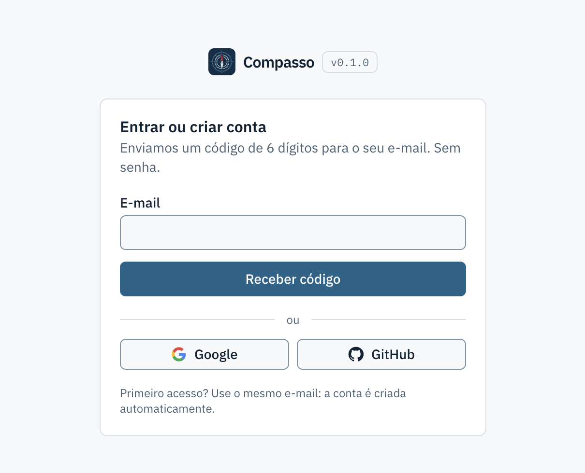

Depois de pedir o código, a tela passa a pedir o código recebido. O código vale por 5 minutos. Se o e-mail estiver errado, "Usar outro e-mail" volta ao passo anterior.

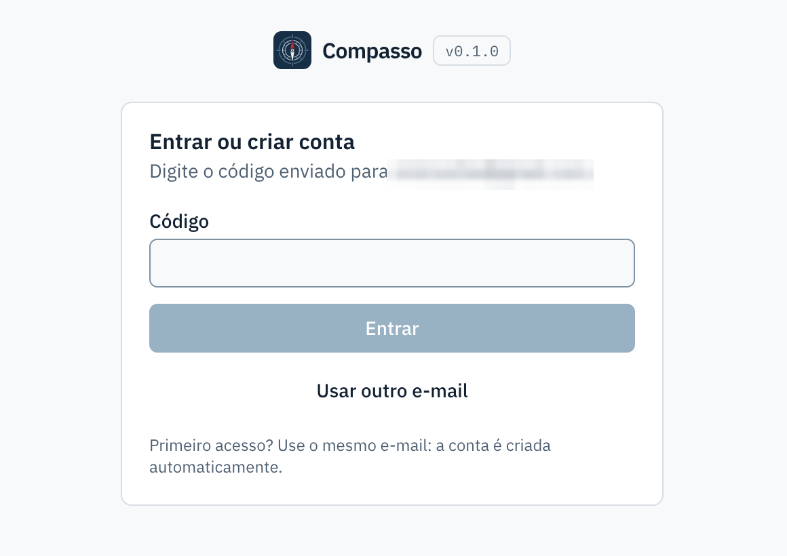

Algumas vezes aparece uma verificação rápida de segurança antes de o código ser enviado (Cloudflare Turnstile). Se o botão ficar em "Verificando…" ou aparecer um aviso de que a verificação não carregou, recarregue a página ou desative bloqueadores de conteúdo para este site.

Na primeira vez o Compasso pergunta como você quer ser chamado e oferece duas saídas: criar um workspace seu ou aceitar um convite que você tenha recebido.

## 2. Como as coisas se organizam

- **Workspace**: o espaço de trabalho de um laboratório, empresa ou consultoria. Tudo o que você cadastra e registra pertence a um workspace, e você pode participar de mais de um.
- **Cliente → Projeto → Tarefa**: a hierarquia usada nos relatórios. O cliente pode ser uma empresa de terceiros ou a sua própria. Tarefas são opcionais.
- **Tags**: etiquetas livres do workspace para marcar registros (por exemplo "reunião" ou "pesquisa").
- **Papéis**: o *proprietário* e os *administradores* veem e corrigem as horas de todos e cuidam dos cadastros. O *membro* registra horas nos projetos em que foi liberado e vê apenas os próprios registros e relatórios.

Todos os horários são mostrados no seu fuso horário (padrão America/Recife).

## 3. Registros: cronômetro e lançamento manual

A tela inicial reúne o cronômetro e o histórico, agrupado por semana e por dia, com o total de cada um.

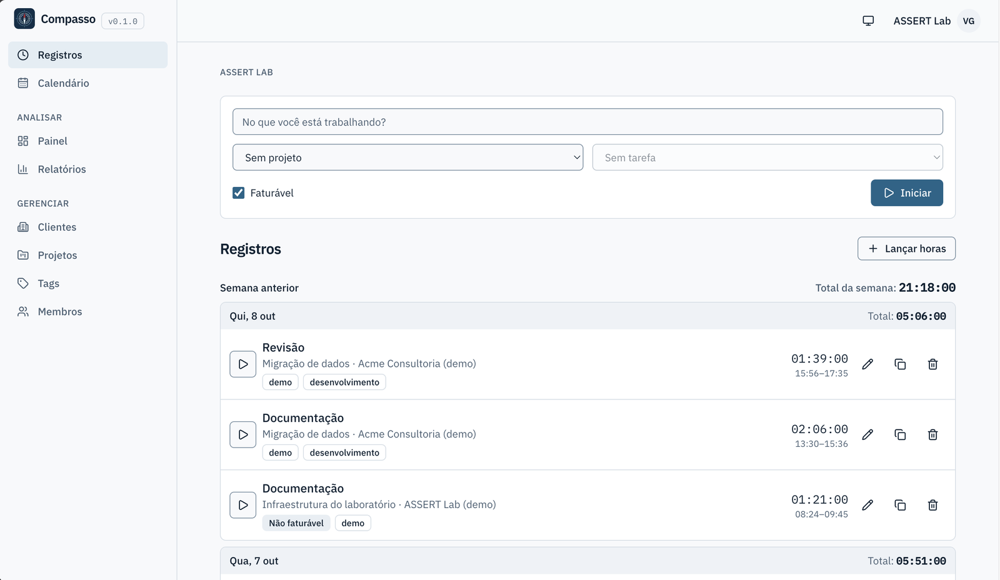

**Cronometrar.** Descreva o que está fazendo, escolha projeto e tarefa se quiser e clique em **Iniciar**. O campo sugere descrições dos seus registros recentes. Enquanto o cronômetro corre, a barra mostra o tempo decorrido e o botão **Parar** encerra o registro. Só pode haver um cronômetro ativo por pessoa: se houver um rodando em outro workspace, o aviso indica onde, e é preciso trocar de workspace para pará-lo.

**Faturável.** A caixa "Faturável" vem marcada. Desmarque para horas que não entram na cobrança; o registro passa a exibir a etiqueta "Não faturável".

**Lançar horas depois.** Para um período que você já trabalhou, use **Lançar horas** e informe descrição, projeto, tarefa, data e hora de início e fim, etiquetas e se é faturável. Quando o fim é antes do início, a data de término passa automaticamente para o dia seguinte (o registro aparece com "+1").

**Cada linha do histórico** tem quatro ações:

- o botão de play **inicia novamente** a atividade: abre um cronômetro novo com a mesma descrição, projeto, tarefa, etiquetas e marcação de faturável;
- o lápis **edita** o registro;
- o ícone de cópia **duplica** o registro, com os mesmos horários, para você ajustar depois (só vale para registros já encerrados);
- a lixeira **remove**. Logo depois aparece o aviso "removido" com a opção **Desfazer**.

Registros do mesmo dia com a mesma descrição, projeto e tarefa aparecem agrupados, com o número de registros num botão que expande o grupo e o total somado.

## 4. Calendário

A visão semanal mostra os registros como blocos, de segunda a domingo, com o total de cada dia no cabeçalho.

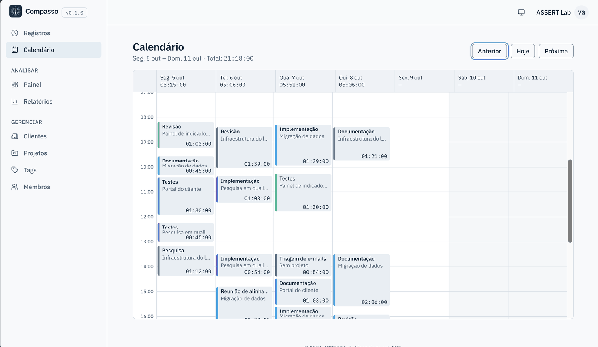

Em telas largas, o calendário também serve para editar:

- clique num bloco para **editar** o registro;
- arraste um bloco para **mover** (inclusive para outro dia);
- arraste a borda de cima ou de baixo para **ajustar** o início ou o fim;
- arraste num espaço vazio para **lançar** um novo período.

Registros com cronômetro ativo não podem ser arrastados. **Anterior**, **Hoje** e **Próxima** navegam entre as semanas.

## 5. Painel

O painel resume o período escolhido com os mesmos filtros dos relatórios (período, cliente, projeto, tarefa, pessoa e agrupamento). No topo ficam o total de horas e os destaques: projeto principal, cliente principal e dia mais cheio.

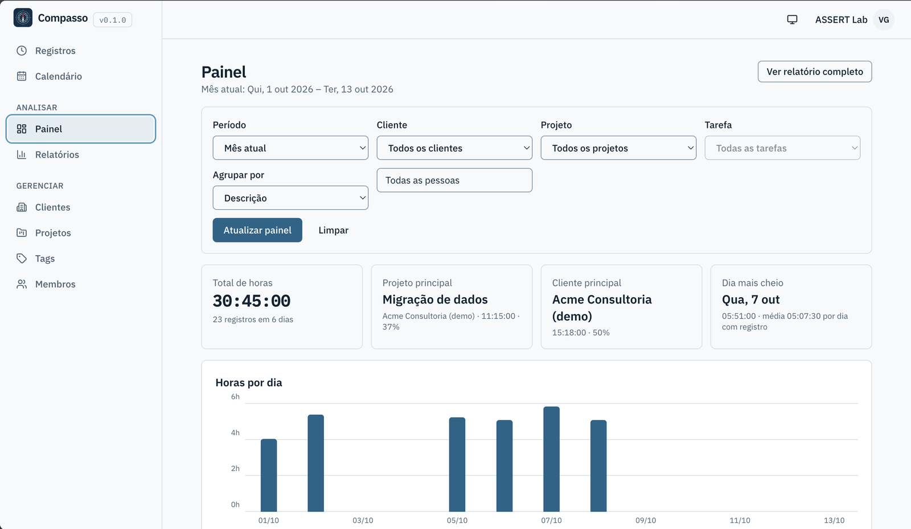

Mais abaixo, o gráfico de horas por dia e as listas de horas por projeto e de principais descrições, com o percentual de cada uma.

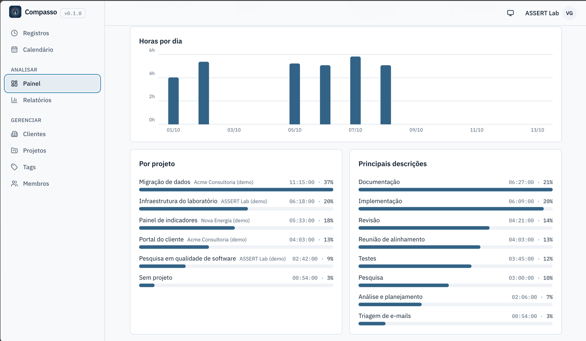

O botão **Ver relatório completo** abre o relatório com os mesmos filtros.

## 6. Relatórios e exportação

É a tela para fechar o mês. Escolha o **período** (mês atual, mês anterior, semana atual, semana anterior, últimos 60 ou 90 dias, ou um intervalo personalizado de até 366 dias), filtre por cliente, projeto, tarefa e, para administradores, pessoa, e escolha o **agrupamento** (por descrição ou por tarefa). Clique em **Gerar relatório**.

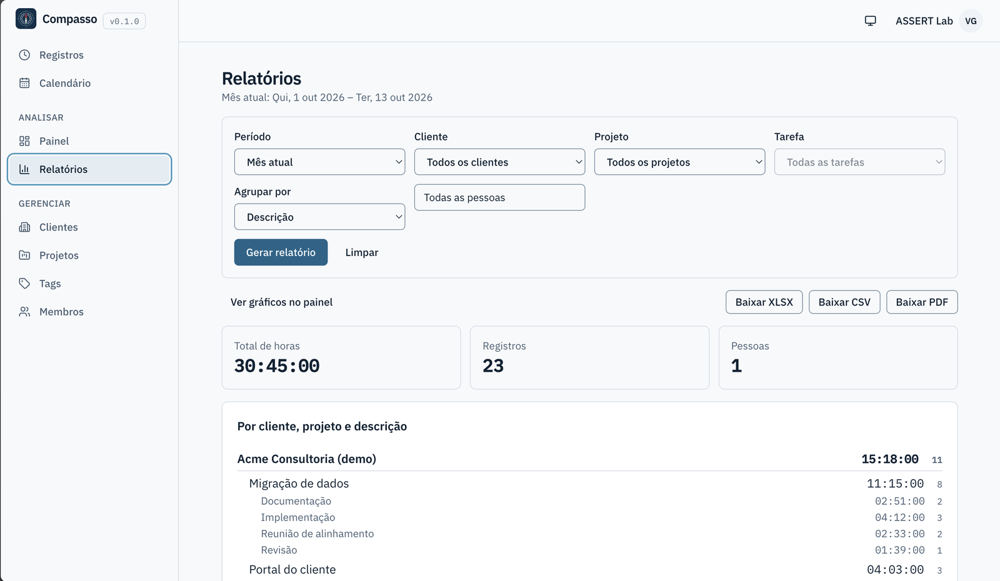

O relatório traz o total de horas, o número de registros e de pessoas e o resumo em árvore (cliente, projeto e descrição ou tarefa). Mais abaixo há a tabela **Por dia** (ou **Por semana**, quando o período passa de 31 dias), com uma linha por projeto e totais, e a lista detalhada dos registros, com um lápis para corrigir cada um.

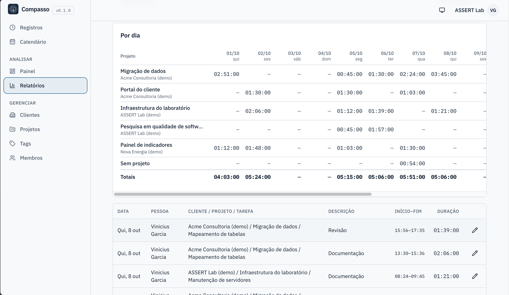

**Exportar.** Os botões **Baixar XLSX**, **Baixar CSV** e **Baixar PDF** geram o arquivo com os filtros aplicados e com todas as linhas (a tela mostra uma parte). Os valores de tempo vão como números, não como texto, para você somar e filtrar na planilha. Para evitar abuso, cada pessoa pode fazer até 10 exportações por minuto e 60 por hora; ao passar disso o download recusa por alguns instantes.

Duas observações:

- membros veem apenas os próprios registros, e o relatório avisa isso;
- ao filtrar por cliente, registros sem projeto ficam de fora, e um aviso indica quantos são e leva a eles.

## 7. Cadastros: clientes, projetos, tags e membros

Em **Gerenciar** ficam os cadastros do workspace. Administradores criam, editam e arquivam; membros apenas consultam.

### Clientes

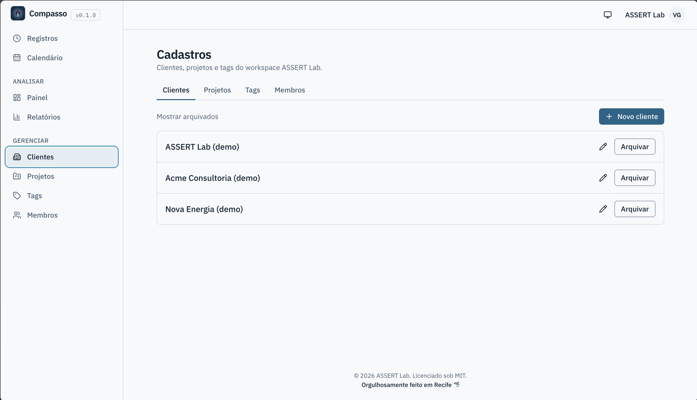

Cadastre quem recebe o trabalho. **Arquivar** tira o cliente de uso sem apagar o histórico, **Mostrar arquivados** exibe os arquivados e **Restaurar** os traz de volta.

### Projetos

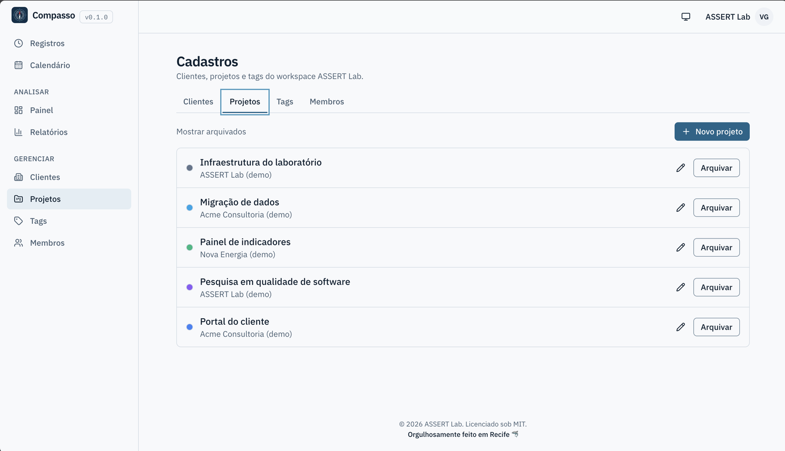

Cada projeto pertence a um cliente e tem uma cor, usada na lista e no calendário. Clique num projeto para abrir a página dele.

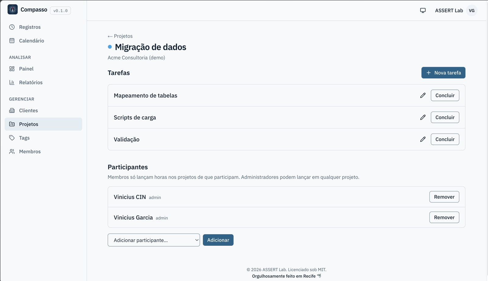

Nela você cria **tarefas** (e marca como **Concluir**, com **Reabrir** se precisar) e define os **participantes**: membros só lançam horas nos projetos de que participam, enquanto administradores podem lançar em qualquer projeto.

### Tags

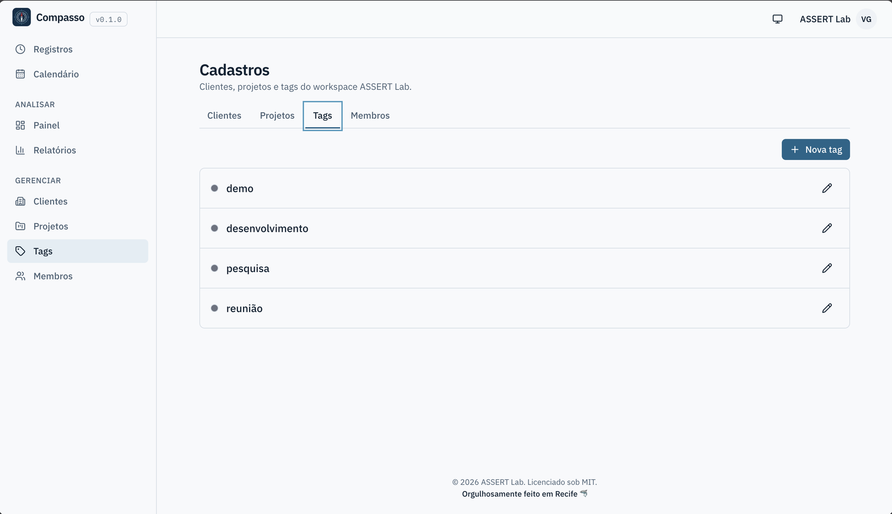

Cada tag tem um nome e uma cor, e aparece como caixa de seleção ao lançar ou editar um registro.

### Membros

Só administradores veem esta aba.

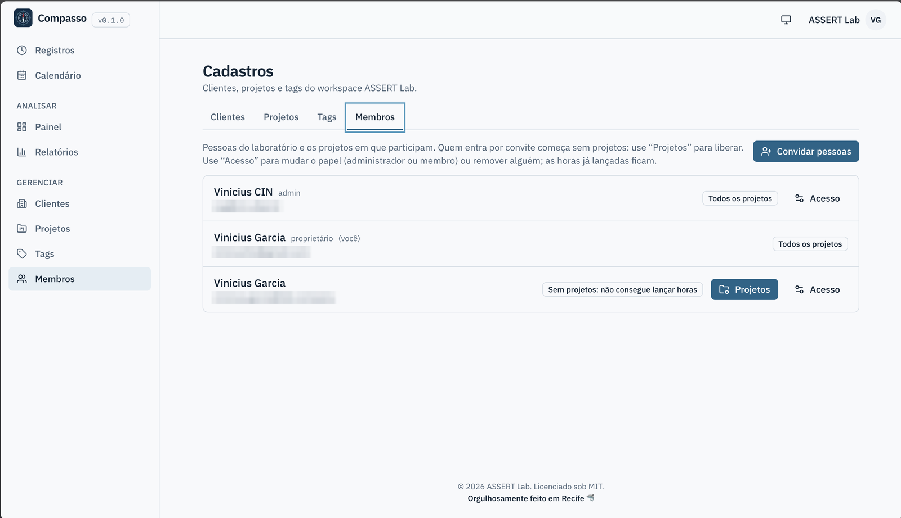

- **Convidar pessoas**: informe o e-mail e o papel (administrador ou membro). A pessoa recebe um e-mail com o link, entra com esse mesmo e-mail e aceita o convite.
- Quem entra por convite começa **sem projetos** e não consegue lançar horas até receber acesso. O botão **Projetos** libera os projetos dela.
- **Acesso** muda o papel (administrador ou membro) ou remove a pessoa do workspace. As horas já lançadas continuam nos relatórios. O proprietário não pode ser rebaixado nem removido.
- Os convites pendentes aparecem só para administradores.

## 8. Conta e workspaces

O nome do workspace e as suas iniciais no canto superior direito abrem o menu da conta.

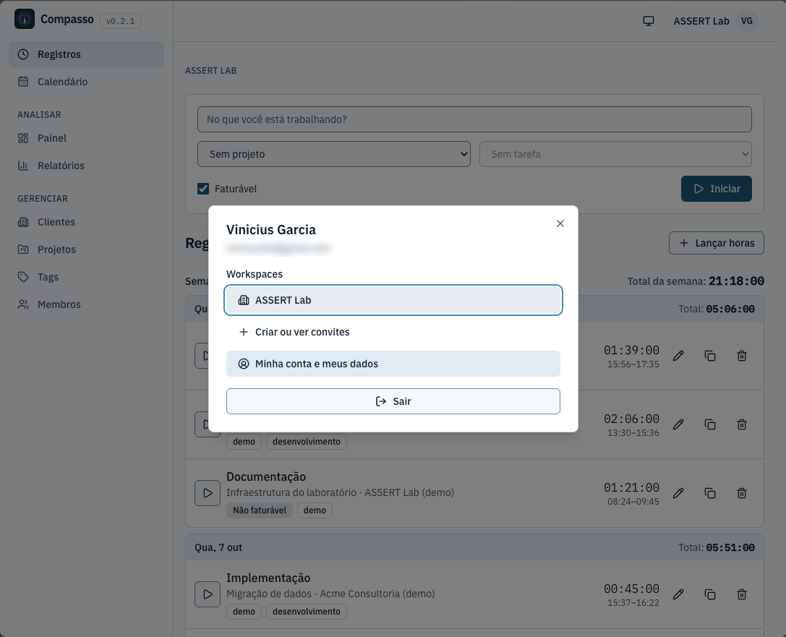

Nele você **troca de workspace**, **cria um workspace** novo, **vê os convites** que recebeu, abre **Minha conta e meus dados** e **sai** da conta. O ícone ao lado (monitor, sol ou lua) alterna o tema entre sistema, claro e escuro.

### Exportar meus dados

Em **Minha conta e meus dados** (`/conta`), o botão **Baixar meus dados (JSON)** baixa uma cópia do que é seu: os registros de horas de todos os workspaces em que você trabalhou (inclusive os removidos, o cronômetro em andamento e os workspaces que você já deixou), com início e término em UTC e o fuso de cada registro, os nomes de clientes, projetos, tarefas e tags que eles usam, e os dados da sua conta. O arquivo não traz dados de outras pessoas nem identificadores internos do banco. Para relatórios por período em planilha ou PDF, use [Relatórios](#6-relatórios-e-exportação).

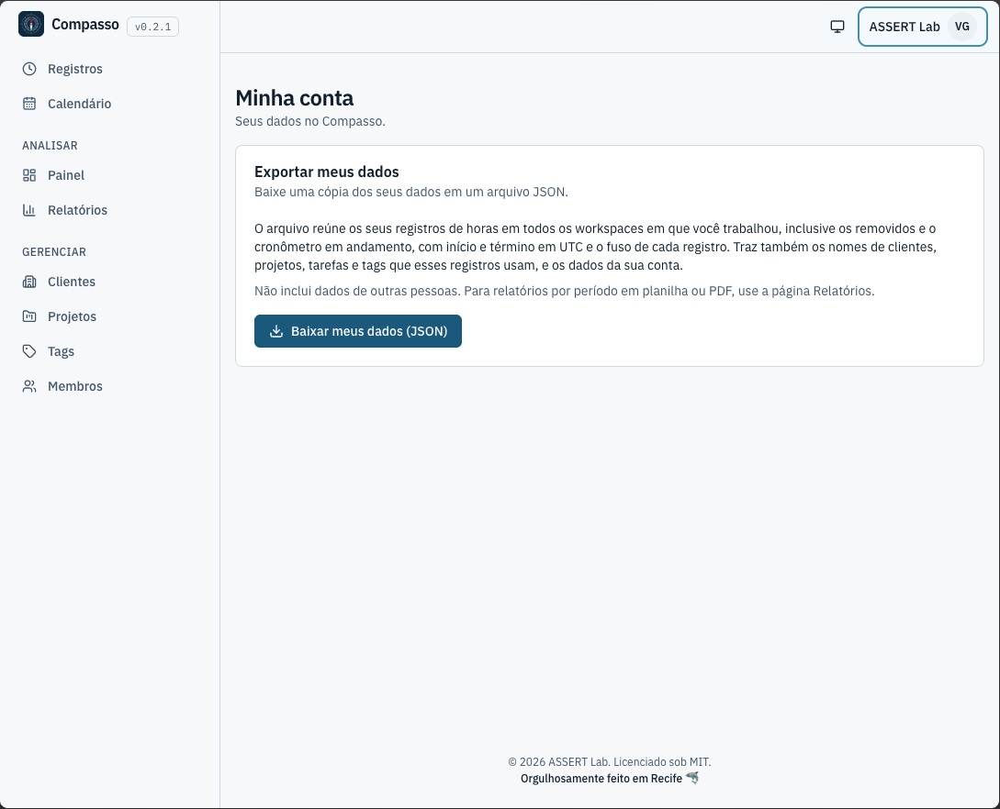

### Excluir minha conta

Na mesma página, o cartão **Excluir minha conta** apaga a sua conta na hora, sem prazo de carência e sem volta. Seu nome, e-mail e acessos são removidos e você sai de todos os workspaces. As horas que você registrou continuam nos workspaces, atribuídas a **Usuário removido**, para que os relatórios já fechados não mudem. Workspaces em que você era a única pessoa são arquivados.

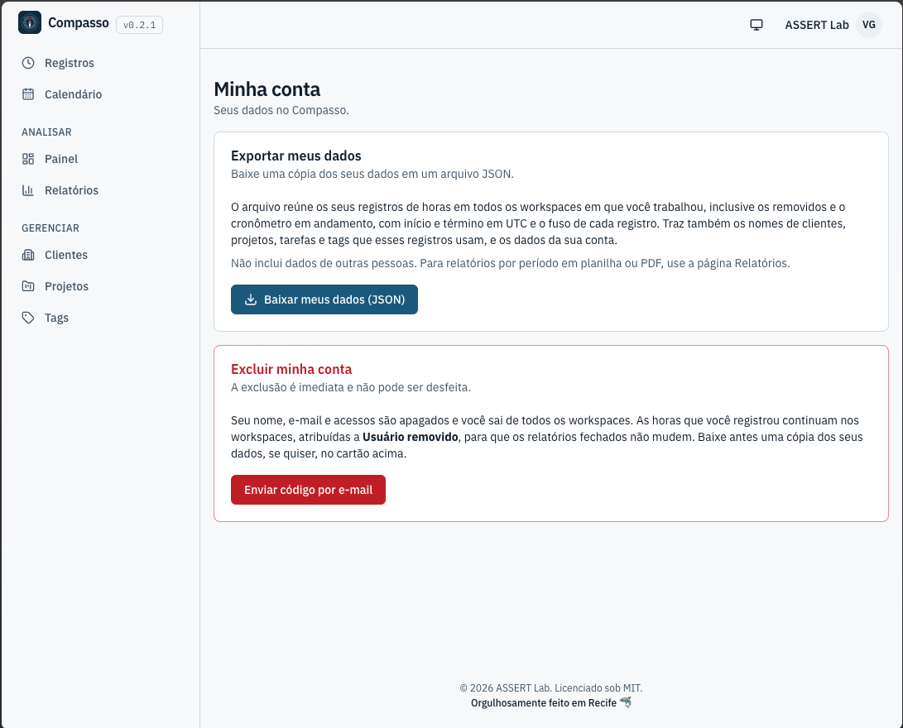

Para confirmar, clique em **Enviar código por e-mail**, digite o código de 6 dígitos (vale 10 minutos) e a palavra **EXCLUIR**. Se você é a única pessoa administradora de um workspace que tem outros membros, o botão não aparece: a tela lista esses workspaces, e é preciso promover outra pessoa a administradora antes. Baixe uma cópia dos seus dados (cartão acima) antes de excluir, se quiser guardá-los.

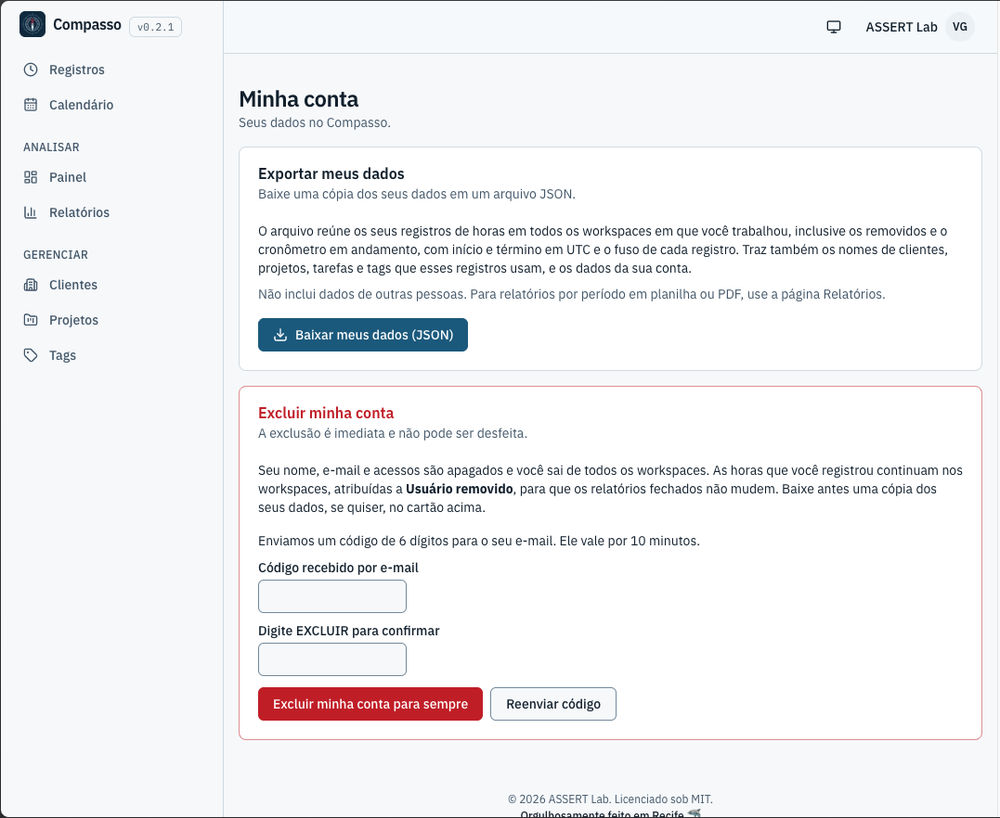

Ao concluir, você volta à tela de entrada com o aviso de que a conta foi excluída.

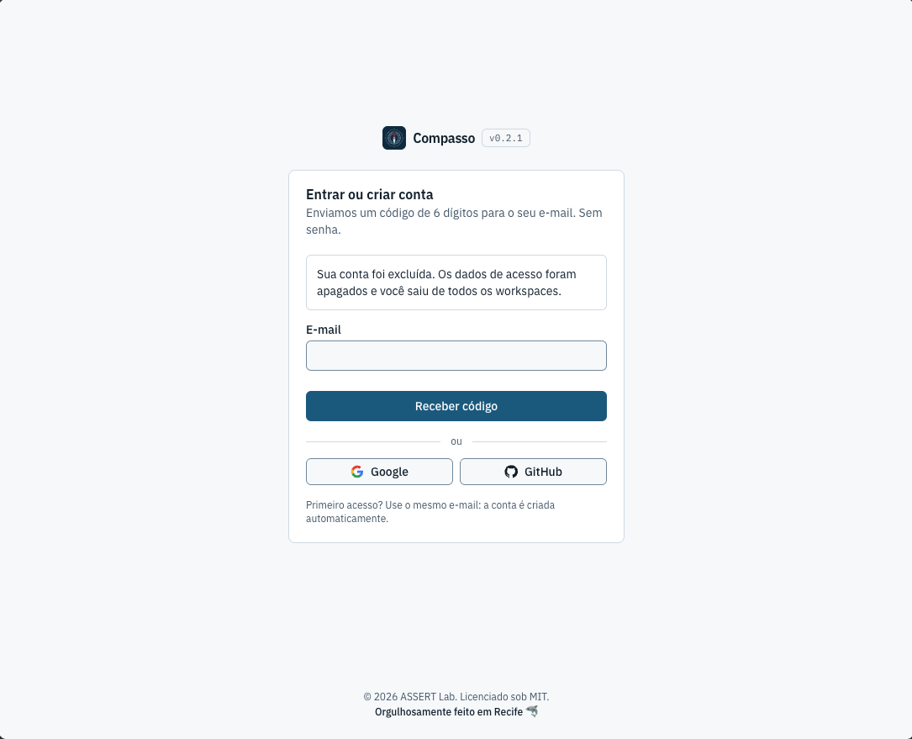

O Compasso é um aplicativo web instalável (PWA): pelo menu do navegador é possível instalá-lo na tela inicial do celular ou do computador.

---

*Este guia acompanha o código: quando uma tela mudar, atualize o texto e as imagens da seção correspondente. As capturas ficam em [`img/`](./img/).*
